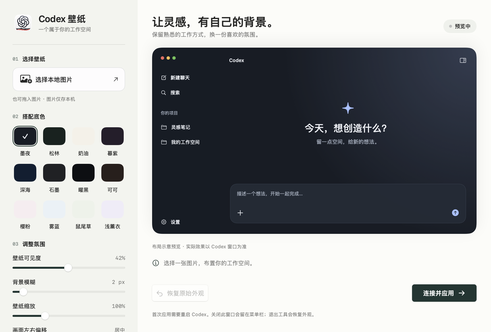

# Codex Wallpaper · Codex 壁纸

为 macOS 上的 Codex 客户端添加本地图片壁纸。支持 Intel 与 Apple Silicon（M 系列）原生运行，一个 Universal 安装包覆盖两种架构。

独立、非官方项目，与 OpenAI 或 ReTheme 无隶属关系。



## 功能

- 选择或拖入本地图片；图片保留在本机。
- 12 套深浅底色：墨夜、松林、奶油、暮紫、深海、石墨、曜黑、可可、樱粉、雾蓝、鼠尾草、浅薰衣。
- 壁纸可见度、模糊、25%–300% 缩放、左右偏移和上下位置。
- 实时布局预览；点击按钮后应用到 Codex。
- 菜单栏常驻、一键恢复、断开连接后自动移除主题。
- ⌘W 关闭设置窗口，⌘M 最小化，⌘Q 退出并恢复外观；Dock 图标可重新打开设置。

当前支持静态图片，不支持视频。它只改变 Codex 窗口内的背景，不改变 macOS 桌面壁纸。

## 系统与客户端要求

| 项目 | 要求／验证状态 |
| --- | --- |
| macOS | 14.0 或以上 |
| 处理器 | Intel x86_64 或 Apple Silicon arm64 |
| 客户端 | `/Applications/ChatGPT.app` 或 `/Applications/Codex.app`，Bundle ID 为 `com.openai.codex` |
| 已验证客户端 | `26.1007.71326`（build `20398`） |
| Intel | 已在 macOS 15.8.1 上进行功能测试 |
| Apple Silicon | 已交叉编译、包含原生 arm64 切片；尚待 M 系列设备实机验证 |

客户端内部 DOM 与样式变量可能随升级变化。检测不到已知主界面时不会强行应用；较新客户端版本需要实际验证。

## 安装

从本仓库的 GitHub Releases 下载 `CodexWallpaper-1.4.0-macOS-universal.dmg`，打开后将 **Codex 壁纸.app** 拖入 **Applications**。也可下载同名 ZIP 解压安装。

当前公开构建使用 ad-hoc 签名，**没有 Apple Developer ID 公证**。从互联网下载后，macOS 可能拦截首次打开。确认文件来源与 SHA-256 后，可按系统提供的“系统设置 → 隐私与安全性 → 仍要打开”流程操作；也可以自行编译。项目不要求关闭 Gatekeeper 或 SIP。

首次点击“连接并应用”时，若 Codex 未开放本机主题通道，会询问是否正常重启客户端。请先结束正在运行的任务。程序不会强制结束客户端，也不会复制或改写其登录数据。

## 使用

1. 选择图片，设置配色、可见度、模糊、缩放和位置。
2. 点击“连接并应用”，按提示连接客户端。
3. 更改设置后点击“应用更改”。
4. “恢复原始外观”移除本工具添加的样式。关闭窗口继续后台运行；退出工具则恢复原始外观。

左右偏移为窗口宽度的 -100% 到 +100%，负数向左、正数向右。100% 缩放表示铺满窗口，小于 100% 可显示更多内容并露出底色。预览与实际窗口宽高比不同，裁切可能不同。

## 本地数据与运行机制

- 配置与壁纸副本：`~/Library/Application Support/CodexWallpaperLocal/`。
- 接受 JPEG、PNG、HEIC、WebP、TIFF，最大 50 MB；导入时生成最长边不超过 2560 像素的 JPEG 副本，原图不变。
- 通过 CDP 临时注入本项目内置脚本；连接前核对客户端身份、可执行文件、进程归属和 `127.0.0.1` 监听地址。
- 不改写客户端 `.app`、`app.asar` 或签名，不读取聊天正文，不上传图片，不加载远程主题。
- CDP 是具有页面调试能力的本机接口；恢复外观后它仍属于当前客户端进程。若要关闭该接口，正常退出 Codex 并从原客户端图标重新启动。
- 控制器心跳失联后，页面通常约 15–17 秒恢复外观。系统休眠、后台计时器延迟可能使恢复稍晚。

## 从源码构建

需要 macOS、Apple Command Line Tools（Swift 6.1 或兼容版本）与用于测试／源码打包的 Python 3。无第三方 Swift 包、Node 或 npm 依赖。

```sh
xcode-select --install   # 未安装开发工具时执行
chmod +x build.sh
./build.sh --dmg
```

脚本分别编译 `x86_64-apple-macosx14.0` 和 `arm64-apple-macosx14.0`，使用 `lipo` 合并为 Universal 二进制，再验证切片与签名。可在 Intel 或 Apple Silicon 的 macOS 开发环境构建；无需同时拥有两种硬件。

输出在 `dist/`：应用、通用 ZIP、可选 DMG 和 `SHA256SUMS.txt`。源码仓库不应提交此目录。

## 验证

```sh
python3 Tests/palette_contrast.py
"dist/Codex 壁纸.app/Contents/MacOS/CodexWallpaper" --ui-self-test
python3 Tests/smoke.py
```

UI 测试需要图形登录会话。客户端集成测试还需要安装上述 Codex 客户端；它启动独立测试实例，可能读取客户端共享的账户与项目元数据，但不发送消息、不编辑聊天、不操作项目文件。请不要同时运行 UI 测试、集成测试或预览进程。

CI 自动验证通用编译、签名、两种架构和配色对比度；CI 不代表已完成不同芯片上的客户端运行验证。

## 发布

运行 `python3 Tools/package-source.py` 生成经过白名单筛选的源码包。发布 `dist/` 中的 ZIP、DMG、源码 ZIP 和校验文件即可；无须上传本机壁纸、测试结果或含个人内容的预览。

`.github/workflows/build.yml` 在推送及 PR 时构建通用 ZIP。它只上传构建产物，不会自动创建或发布 GitHub Release。Developer ID 签名和公证需要维护者自己的 Apple 开发者凭据，当前流程不包含这些凭据。

## 许可与致谢

原创代码采用 [MIT License](LICENSE)。本机 CDP 思路参考 [ReTheme](https://github.com/duxweb/ReTheme)，相关 BSD 许可和说明保留在 [NOTICE.txt](NOTICE.txt)。

应用图标参考 ChatGPT 标识，经 AI 生成；OpenAI 名称及标识不包含在本项目的 MIT 授权范围内。用户自选壁纸也不随开源包分发。详见 NOTICE.txt。
